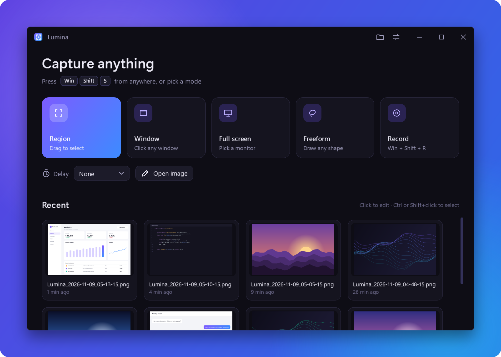
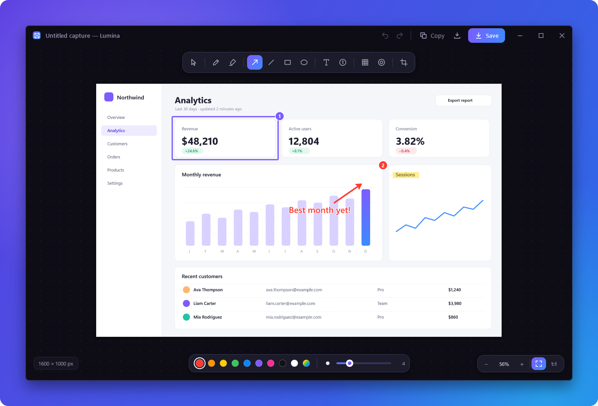
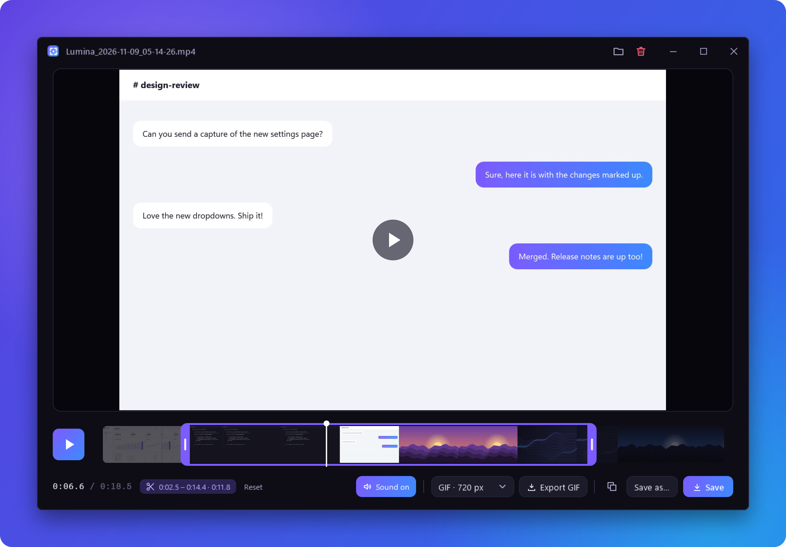
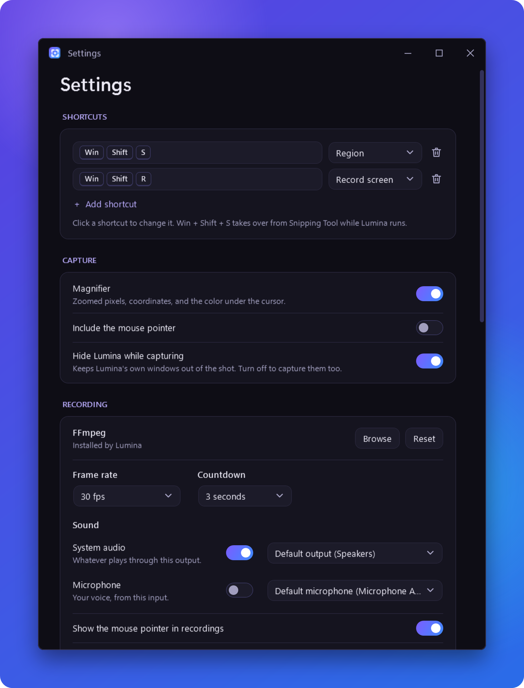

# Lumina

A lightweight, modern screenshot and screen recording tool for Windows - a replacement for Snipping Tool with a fast capture overlay, a floating preview, a non-destructive markup editor, and screen recording with a trim editor.

> **Alpha.** Lumina is early and under active development. Expect rough edges, and please report anything that breaks.



## Features

### Capture
- **Four modes**: Region, Window, Full screen and Freeform (lasso).
- **Win + Shift + S** opens Lumina instead of Snipping Tool while it's running (toggle in Settings). Print Screen can be used too.
- **Frozen-screen overlay**: the screen is captured up front, so menus and tooltips stay put while you select.
- **Smart highlighting**: hover a window to capture it in one click; the highlight glides between targets.
- **Precision tools**: magnifier with pixel grid, coordinates and color under the cursor; arrow-key nudging (Shift = 10px); live size readout.
- **Multi-monitor and per-monitor DPI aware.**
- **Capture delay**: 3/5/10 second countdown from the home window.

### After capture
- Copies to the clipboard and saves to your output folder (both optional).
- A **floating preview** slides into the corner: drag it straight into another app, copy, save, edit or delete.
- Customisable file names (`{yyyy}-{MM}-{dd}`, `{app}`, counters…), PNG or JPEG.

### Markup editor
- **Tools:** select/move, pen (with stroke smoothing), highlighter, arrow, line, rectangle, ellipse, text, numbered steps, redact, spotlight and crop.
- **Redact** with mosaic, blur or a solid cover, with adjustable strength.
- **Spotlight** with rectangle or ellipse shapes, adjustable darkness and optional background blur.
- **Crop** with aspect-ratio presets (Free, Original, 1:1, 4:3, 3:2, 16:9, 9:16).
- **Color picker**: presets plus a full HSV picker, hex input, eyedropper and recent colors.
- **Non-destructive**: markup stays editable after saving; reopen a capture to keep working on it.
- Open any image file from the home window to mark it up.
- Smooth zoom (Ctrl + scroll zooms around the cursor), fit-to-window and 1:1, full undo/redo.



### Screen recording
- **Win + Shift + R** (or the Record card / tray menu) picks a region, window or screen with the same overlay, then counts down and records.
- **Sound**: system audio and/or microphone, each with its own device. Pick devices and mute either source right from the overlay's toolbar.
- **Recording bar**: timer, pause/resume, stop, per-source mute and discard. It never steals focus and never shows up in the video.
- **Movable area**: drag the recording outline (or its tab) to follow what you're recording.
- **GPU encoding** with NVIDIA, Intel or AMD when available, falling back to x264; 30 or 60 fps.
- **Trim editor** opens when you stop: drag the handles on the filmstrip, then save, save as MP4 or GIF, export a GIF at a chosen width, or copy the file.
- **Straight to the clipboard**: finished recordings and exported clips are copied as files, ready to paste into a chat or folder (follows the same *Copy to clipboard* setting as screenshots).
- Uses **FFmpeg**: Lumina downloads it for you on first run (about 115 MB, one click), or point it at your own `ffmpeg.exe` in Settings.



### Gallery
- Recent captures on the home window, with multi-select (click the corner circle, or Ctrl / Shift + click), copy, reveal in Explorer and delete to the Recycle Bin.

<p align="center"></p>

## Install

Download the latest build from the [Releases](../../releases) page:

- **`Lumina-…-win-x64.zip`**: self-contained, no install or runtime needed. Unzip anywhere and run `Lumina.exe`.
- **`Lumina-…-win-x64-framework.zip`**: much smaller, but needs the [.NET 10 Desktop Runtime](https://dotnet.microsoft.com/download/dotnet/10.0).

Lumina lives in the system tray. Settings are stored in `%AppData%\Lumina`. For a fully **portable** setup, create an empty file named `portable` next to `Lumina.exe` and everything will be kept in a `data` folder beside it.

> Windows SmartScreen may warn about an unrecognised app because the builds aren't code-signed yet. Choose *More info → Run anyway*.

## Shortcuts

| Where | Keys | Action |
| --- | --- | --- |
| Anywhere | `Win + Shift + S` | Start a capture |
| Anywhere | `Win + Shift + R` | Start a recording, or stop the one running |
| Overlay | `1` `2` `3` `4` / `R` `W` `S` `L` | Region / Window / Screen / Freeform |
| Overlay | `F` or `Enter` | Capture the screen under the cursor |
| Overlay | Hold `Space` while dragging | Move the selection |
| Overlay | Arrow keys (`Shift` = ×10) | Nudge the selection |
| Overlay | `Esc` / right-click | Cancel (right-click first clears a selection in progress) |
| Editor | `V` `P` `H` `A` `L` `R` `E` `T` `N` `B` `S` `C` | Select, pen, highlighter, arrow, line, rectangle, ellipse, text, steps, redact, spotlight, crop |
| Editor | `[` / `]` | Smaller / larger brush |
| Editor | `Ctrl + Z` / `Ctrl + Y` | Undo / redo |
| Editor | `Ctrl + C`, `Ctrl + S`, `Ctrl + Shift + S` | Copy, save, save as |
| Editor | `Ctrl + 0` / `Ctrl + 1` / `Ctrl + scroll` | Fit, actual size, zoom |
| Trim editor | `Space` | Play / pause |
| Trim editor | `←` / `→` (`Shift` = 5 s) | Step a frame |
| Trim editor | `I` / `O`, `Home` / `End` | Set trim start / end, jump to start / end |
| Trim editor | `Ctrl + C`, `Ctrl + S` | Copy the video, save the trim |

## Building from source

Requirements: Windows 10/11 and the [.NET 10 SDK](https://dotnet.microsoft.com/download/dotnet/10.0).

```bash
git clone https://github.com/itspixxel/Lumina.git
cd Lumina
dotnet run --project src/Lumina
```

To produce a self-contained single-file build:

```bash
dotnet publish src/Lumina -c Release -r win-x64 --self-contained -p:PublishSingleFile=true -p:IncludeNativeLibrariesForSelfExtract=true -o publish
```

### Project layout

```
src/Lumina/
  Capture/    screen capture, the selection overlay and capture animations
  Editor/     markup document, annotations and the editing canvas
  Recording/  screen recorder, WASAPI audio capture, FFmpeg setup and the recording flow
  Services/   settings, output, clipboard, global hotkey hook, startup
  Views/      home, editor, settings, preview, dialogs and the motion helpers (Fx)
  Themes/     the "Midnight" design system
tools/        icon generator
```

## Roadmap

- [x] Capture overlay, quick preview, markup editor, settings
- [x] Gallery with multi-select
- [x] Screen recording (video and GIF) with a trimming editor
- [ ] Full gallery view with search
- [ ] Optional short-link uploads (temporary, self-hosted storage)
- [ ] Installer and auto-update

## Status

Lumina is a personal project in alpha. Issues and suggestions are welcome.
